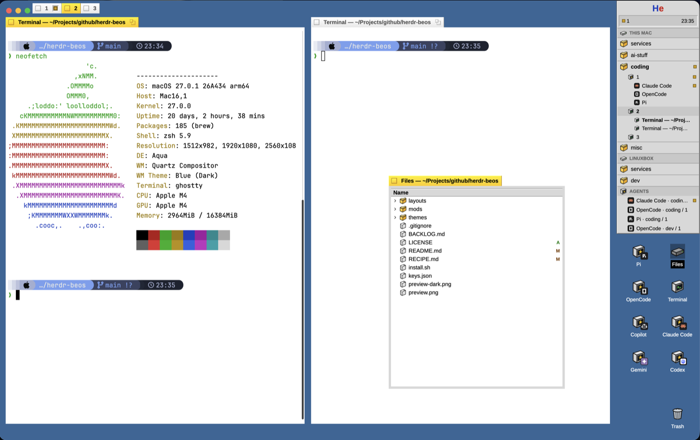
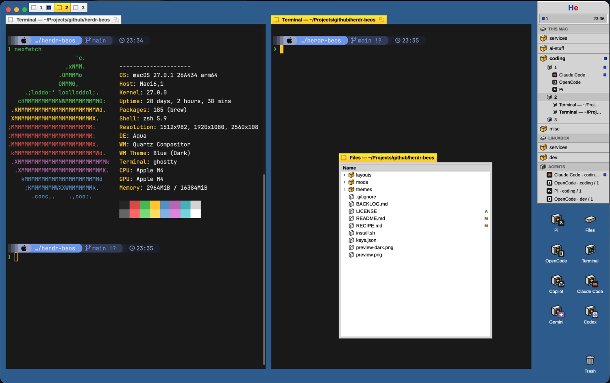

# Herdr BeOS

A layout for [Herdr](https://herdr.dev) inspired by BeOS R5. It turns the Herdr window into a blue desktop with yellow-tabbed terminal windows, a Stack & Tile tab strip, a Deskbar, a Twitcher, Tracker-style file windows, desktop launchers, and BeOS-style alert dialogs. It is an independent fan tribute; see [Trademarks](#trademarks).



With dark terminals (the theme follows the system by default):



> **Tested on macOS only.** It should work wherever Herdr runs, but Linux and Windows haven't been tried yet: the traffic-light position, the `ps` call used to detect a fresh start, and `test -f` for the startup sound assume a Unix-like system. Reports and fixes are welcome.

## Install

With Herdr running:

```sh
./install.sh
```

The script installs the BeOS shell plus the Files, Changes, and Graph clones, both terminal themes, the layout preview asset, and the layout itself when it is not already installed. It checks all four mods before it finishes.

The installer never touches `keys.json` by itself. To make Ctrl+Tab open the Twitcher in this layout, merge the repository's `keys.json` section into yours:

```sh
./install.sh --keys
```

It adds `layout:beos` bindings (`ctrl-tab` → `beos.twitcher`, `ctrl-shift-tab` → `beos.twitcherPrev`) only when those chords are not already bound there. A key you already bind is kept and reported. Without `--keys`, `keys.json` is not read or written. To try the merge on a copy, point `HERDR_KEYS_FILE` at it.

The installed layout is intentionally treated as user state because the Be menu can rewrite its terminal theme. To replace that existing copy with the repository version, run:

```sh
./install.sh --layout
```

## Startup sound

No sound ships with this repository. To hear one when the boot screen appears, put an MP3 at `~/.config/herdr-app/mods/beos/sounds/startup.mp3`; `./install.sh` keeps an MP3 already installed (it is git-ignored). Or put it at `mods/beos/sounds/startup.mp3` in this repository and run `./install.sh` to copy it. The Be menu's **Startup Sound** item toggles it (on by default when the file exists) and it respects Herdr's sounds setting. `startup.mp3` is only played on entering BeOS, never on a mod reload.

Convert a WAV, AIFF or OGG to the MP3 this mod plays:

```sh
ffmpeg -i input.wav -ac 1 -b:a 96k startup.mp3
```

Sources, each with its license:

- **Basics** by ffbsoffa, <https://github.com/ffbsoffa/basics> (`startup.wav`): original sounds inspired by BeOS, CC-BY-SA-4.0.
- **Haiku Sounds** by Pete Goodeve, <https://goodeveca.net/haiku/sounds.html> (e.g. `MELODIC/RunUp_Shakuhachi.ogg`): made on Haiku, no published license — personal use.
- **BeOS 4.5 Sounds** on the same page (`BeStartup.aiff` is the BeOS original), by Be, Inc., no license — personal use, do not redistribute.

## Development

Edit files in this repository, then run `./install.sh`. Herdr reloads the copied files while it is running.

The installer copies instead of symlinking. Herdr's hot reload and image cache do not follow symlinks reliably, so linked mods and assets can remain stale after an edit.

Issues and pull requests are welcome. Before sending a change, make sure `./install.sh` passes `herdr-app check` for every mod, and attach a screenshot if it changes anything visible.

## What it includes

- **Window tabs.** Each terminal pane has a 22 px BeOS decorator tab: yellow `#ffcb00` when focused and gray `#e8e8e8` otherwise, with close and zoom boxes. A pane running an agent shows its status lamp in a small sunken well between the title and the zoom box: pulsing amber `#d29e00` while working, red `#d01010` when blocked, blue `#1c50c8` when done. Idle agents and plain shells show none. Right-clicking a pane tab opens its window menu: Split Right, Split Down, Zoom (checked when zoomed) and Close.
- **Tab strip.** The 36 px band above the panes holds one BeOS window tab for each awake Herdr tab of the active space, after the macOS traffic lights. The active tab is yellow, the others gray, each with the tab's agent lamp. A click selects the tab; a right-click offers Rename…, Hide and Close Tab (with the BeOS confirmation). Hide switches to another awake tab, then puts this one away. Hidden (put-away) tabs stay out of the strip; the Deskbar keeps them, dimmed, at the end of the list; a lone tab still shows, and extra tabs are clipped with `…`.
- **Twitcher.** In BeOS, Ctrl+Tab opens a centered gray strip with the 32 px icons of the active space's panes and of the agents shown elsewhere, pinned first. Panes of hidden tabs come last and are dimmed; choosing one shows its tab again. The chosen icon sits in a sunken box and its name shows below. Tab or right advances, Shift+Tab or left goes back, Enter or a click jumps, Escape cancels, and letting go of Ctrl jumps. Each icon carries its agent lamp. It needs `./install.sh --keys` once.
- **Deskbar.** A 180 px column on the right contains the “He” menu, status counts and clock, spaces grouped by machine, tabs (hidden ones dimmed at the end), split panels, and an AGENTS section. Agent rows can focus and pin agents; `agent.next` and `agent.prev` follow the displayed order. Agent and agent-panel rows show the program's own logo in a dark 14 px tile (the generic agent icon when it has none); shells keep the terminal icon.
- **Be menu.** About, start terminals or spaces, open or close Files, Changes, and Graph windows, enable or disable the Boot Screen and the Startup Sound, switch layouts, open Settings or the command palette, and choose light, dark, or system-following terminal colors. All three application mods ship with this repository.
- **Desktop.** Launch a terminal or any installed agent, open the Files window, and use the Trash menu to close the current tab or space. Launchers fill up to two columns, shrink on short screens, and move any remaining entries into the Trash menu instead of overlapping.
- **Boot screen.** Every entry into the layout can show a skippable black startup screen with a large blue/red “He” mark and seven local icons lighting from left to right. It does not replay on an ordinary mod reload and is enabled by default. It can play an optional startup MP3; see [Startup sound](#startup-sound).
- **Application windows.** Files is a 380 × 460 Tracker window backed by `beos-files`; Changes and Graph are 520 × 480 windows backed by `beos-changes` and `beos-graph`. All three follow the focused pane's folder, have independent remembered positions, and can remain open together. Changes uses a BeOS menu bar, sunken file/diff wells, and Cancel/Commit controls; Graph uses a white history document with beveled headers and square controls.
- **Alerts.** Rename and close actions launched from the Deskbar, tab strip and Trash use 360 px BeOS-style dialogs with a vertical stripe, dimensional icons, beveled buttons, Enter for the default action, and Escape to cancel.
- **Terminal themes.** `beos.json` is light; `beos-dark.json` keeps dark terminal colors while retaining dark text on the light BeOS chrome. The Be menu can choose either one or follow the system.
- **Sidebar toggle.** Cmd+B (`layout.toggle:sidebar`) hides and restores the entire Deskbar and desktop-icon column.

## Credits

The interface uses **Arimo**, distributed under the SIL Open Font License; see [`mods/beos/fonts/OFL-Arimo.txt`](mods/beos/fonts/OFL-Arimo.txt).

`mods/beos-files` and `mods/beos-changes` are clones of Herdr's shipped `files` and `changes` mods, restyled while preserving their behavior. Their clone metadata records the source versions.

`mods/beos-graph` is a modified clone of [herdr-git-graph](https://github.com/rabeeh-ta/herdr-git-graph) by [Rabeeh T A](https://github.com/rabeeh-ta), distributed under the MIT License; see [`mods/beos-graph/LICENSE`](mods/beos-graph/LICENSE). Its Lucide-derived icons retain their ISC notice in [`mods/beos-graph/icons/LICENSE-lucide.txt`](mods/beos-graph/icons/LICENSE-lucide.txt). The clone deliberately omits the original daily GitHub update request: it performs no automatic HTTP checks and is updated only with Herdr BeOS.

The decorator colors are based on BeOS R5 values documented in Haiku's source code.

## License

Herdr BeOS is licensed under the [Apache License 2.0](LICENSE), Copyright 2026 Christian Sánchez, the same license as Herdr itself. Exceptions that keep their own licenses:

- `mods/beos-files` and `mods/beos-changes` are derived from Herdr's `files` and `changes` mods (Apache-2.0, Copyright the Herdr authors); see the `NOTICE` file in each folder.
- `mods/beos-graph` is MIT-licensed (git-graph by Rabeeh T A); see its `LICENSE`. Its Lucide icons are ISC-licensed.
- The Arimo fonts are under the SIL Open Font License.
- Any startup sound you add keeps its own license (see [Startup sound](#startup-sound)).

## Trademarks

BeOS and Be are trademarks of their respective owners. This project is an independent fan tribute inspired by BeOS R5; it is not affiliated with or endorsed by them. The icons and the “He” logo (inspired by the arrangement of the Be logo, but not the Be trademark) are original drawings made for this project, and none of them is presented as an official logo.
