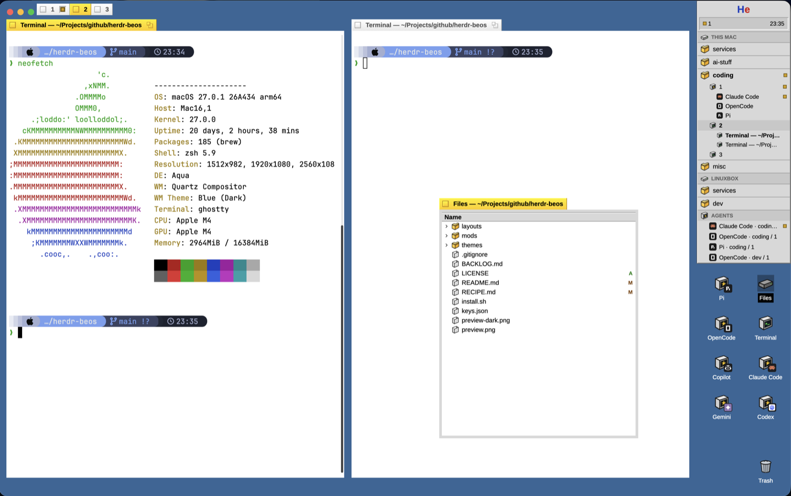

# Herdr BeOS

A Herdr desktop inspired by BeOS R5 (an independent fan tribute, not affiliated with Be or its successors): terminal panes look like white or dark windows on a `#336698` desktop, their decorator tabs turn yellow when focused, and a gray Deskbar on the right combines machines, spaces, tabs, panels, agents, launchers, Tracker, and Trash.

## What you see

- Before the desktop, a modal black boot screen can show a centered 110 px blue/red “He” mark and seven 56 px purple stage discs with 36 px icons. The local disk, folder, terminal, agent, information, warning, and Trash icons illuminate from left to right over 2.7 seconds. Below 620 px wide, the whole group scales down to remain visible.
- The root is a blue `#336698` desktop with no system title bar. On macOS, traffic lights sit at `[14, 14]`.
- The main work area fills the space left by a fixed 180 px right column. Its top band is 36 px tall and holds the tab strip; below it the panes have 14 px gaps, 5 px terminal padding and a 36 px bottom margin. A 14 px horizontal padding frames it all.
- The tab strip draws one 22 px window tab per awake tab of the active space, bottom-aligned in the 36 px band and inset 58 px from the left so the macOS traffic lights stay clear. The active tab is yellow `#ffcb00`; the others use `#e8e8e8`. Each has a 12 px close box, a bold tab name, and the tab's status well when its agent is working, blocked or done. Tabs touch edge to edge, and the row is clipped with `…` when it does not fit.
- Every pane has a 22 px decorator tab at its top-left. The focused tab uses `#ffcb00`; an unfocused one uses `#e8e8e8`. Each has a 12 px close box, a bold title, a 13 px sunken status well holding a 7 px agent lamp when that pane's agent is working, blocked or done, and a double-square zoom box.
- Ctrl+Tab (after `./install.sh --keys`) opens the Twitcher, as in BeOS, in the middle of the window: a raised `#d8d8d8` strip, 76 px tall, with 32 px icons in 42 px slots and the chosen one in a sunken `#999999` box. Its name sits below in 12 px Arimo, and the strip is as wide as its icons or its longest name, capped to the window with `…` at a cut end.
- The 180 px Deskbar begins at the top right. Its raised gray face is `#d8d8d8`, with white highlights, `#989898` shadows, and `#606060` dark edges.
- The Deskbar starts with a 30 px “He” button: blue `#1c3fbf` H, red `#d01010` e. Below it is a 22 px sunken status well with blocked, done, and working counts plus a clock.
- The application list groups spaces by machine. Machine headings are 20 px high; space rows are 24 px; tab rows are 20 px. A tab with multiple panes expands to 18 px panel rows indented 36 px.
- The AGENTS heading and its 20 px rows appear only when agents exist. Each row reads `<program> · <space> / <tab>` and ends in a status lamp; it starts with the program's own logo in a dark 14 px tile, or the generic agent icon when the program has none. Split panel rows use the same logo at 12 px, and shells keep the terminal icon.
- Desktop launchers fill the right edge below the Deskbar from top to bottom, then a second 84 px column to the left. Normal icons are 32 px in 76 px slots with 11 px labels. On short screens they become 24 px icons in 58 px slots with 10 px labels. Trash stays in the bottom-right slot.
- The Be menu (and, for Files, the desktop icon) opens three independent yellow-tabbed application windows: Files at 380 × 460, Changes at 520 × 480, and Graph at 520 × 480. Their titles are `Files — <folder>`, `Changes — <folder>`, and `Graph — <folder>`. All use fixed white document surfaces in light and dark appearance. Changes has a 20 px BeOS menu bar, separate sunken file and diff wells, and Cancel/Commit controls; Graph has beveled history headers and square scope, remote, fetch, and refresh controls.
- Rename dialogs are 360 × 178; confirmation dialogs are 360 × 156. They use a raised `#d8d8d8` panel, a 30 px `#bfbfbf` stripe, a 32 px icon crossing the stripe, and 24 px beveled buttons. The default button has a 2 px black frame.
- UI text uses Arimo at 12 px. Terminal text keeps the person's terminal font.
- The light terminal theme uses `#ffffff` behind `#000000`; the dark theme uses `#1a1a1a` behind `#e8e8e8`. Both keep the BeOS chrome colors.

## How it behaves

- The boot screen appears on the first BeOS entry in a Herdr process and every time the layout is left and entered again. The exported View delegates lifecycle cleanup to the Deskbar: its `close()` stores `beos.left`, and the next Deskbar consumes that mark. A stored process-start estimate handles the first entry. Ordinary `./install.sh` hot reloads call neither lifecycle path, so they do not replay it. Click or Escape skips it; `beos.bootScreen` defaults on and the Be menu's checked Boot Screen item toggles it. If `mods/beos/sounds/startup.mp3` exists and Herdr's sounds are on, it also plays it (never on a reload) unless the Be menu's Startup Sound is off; the repo ships no MP3 and `install.sh` protects an installed one from `--delete`.
- Clicking a pane tab focuses it; double-clicking the tab zooms it. The left box closes the pane and the right box toggles zoom. A status lamp in a 13 px sunken BeOS well, between the title and the zoom box, shows the pane's agent: pulsing amber `#d29e00` while working, red `#d01010` when blocked, blue `#1c50c8` when done. The well's gray face, inverse bevel and a 1 px bezel in a darker tone of the status color keep the lamp readable on the yellow tab and while a working lamp fades. Idle agents and plain shells show no lamp, so a shell's tab reads exactly as before. Right-clicking a pane tab opens its menu under it: Split Right, Split Down, Zoom (checked when zoomed) and Close; the Tracker's window tab has no menu.
- The tab strip selects with a click and opens the same kind of BeOS menu on a right-click: Rename… (the Deskbar's alert), Hide and Close Tab (the confirmation). Hide runs `tab.select` on the next awake tab and then `tab.settle` on its own (disabled when no other awake tab); settled tabs leave the strip and stay in the Deskbar list, dimmed at the end, where a click or Show runs `tab.unsettle` and brings them back. A lone tab still shows; overflow is clipped with `…`.
- Clicking a space or tab selects it. Clicking a panel row focuses that exact pane. Right-click opens the relevant BeOS menu.
- A working agent has a pulsing amber `#d29e00` lamp. Blocked is red `#d01010`; done is blue `#1c50c8`; idle and unknown reserve an empty 7 px lamp slot. The status well counts blocked, done, and working agents.
- Pinned agents stay above unpinned agents. Clicking an agent runs `agent.focus`; its menu can run `terminal.pin`. `setAgentOrder` makes `agent.next` and `agent.prev` follow this displayed order.
- Clicking the clock shows `DD/MM/YYYY` for three seconds, then returns to `HH:MM`.
- The Be menu creates a terminal or space; toggles the bundled Files, Changes, and Graph clones under Applications; switches layouts; opens the command palette or Settings; and selects Follow the system, Light, or Dark terminal colors.
- Changing terminal colors rewrites the shown installed layout's root `theme`: auto is `{ "light": "beos", "dark": "beos-dark" }`, light is `"beos"`, and dark is `"beos-dark"`.
- A single click selects a desktop icon; a double-click opens it. Terminal and agent icons create tabs. The Files icon opens the Files window for the focused pane's folder. Trash opens close actions for the focused tab and space. The desktop measures its available height, fills the right column before the left, switches to compact icons when needed, and adds launchers that still do not fit under “More launchers” in the Trash menu.
- Close and rename actions launched from this layout use BeOS dialogs. Enter accepts the default action; Escape cancels. Closing the only tab warns that its space closes too. An empty rename restores Herdr's automatic name.
- Tracker follows the focused pane's folder and machine. Folder rows expand lazily; local folders are watched; remote and Windows folders are refreshed through commands. Directories sort before files, then by name.
- Tracker shows git marks A, U, D, or M. Clicking a file replaces the tree with a bounded read-only preview; Back returns to the tree. Binary, missing, oversized, and unreadable files get explicit messages.
- Cmd+B runs `layout.toggle:sidebar` for node `sidebar`, hiding or restoring the Deskbar and all desktop icons.
- Hovering menu rows, Deskbar rows, file rows and alert buttons darkens them to the `#999999` selection (alert buttons fade slightly). The tab's close and zoom boxes have no hover or pressed state yet.
- Ctrl+Tab (after `./install.sh --keys`) opens the Twitcher one item past the focused pane. `Tab` or right advances, Shift+Tab or left goes back, Enter or a click jumps, Escape cancels, and letting go of Ctrl jumps to the chosen item. It lists the active space's panes in order (those of hidden tabs last and dimmed; choosing one runs `tab.unsettle` first), then the agents the Deskbar lists, pinned first; an agent already shown as a pane is not listed twice, and a 1 px engraved rule (`C.shadow` then `C.light`) separates the two groups. An outside agent's name reads `OpenCode — dev / 1`, plus ` @ linuxbox` when it is on another machine. Icons are the BeOS agent box with the program's own badge, the terminal for a plain shell, and the agent lamp top-right. Choosing a pane runs `pane.focus`; choosing an agent runs `agent.focus`.

## Built from

- `layouts/beos.json` is a root `row` with two children:
  - `main`, a `column` with `window_drag: true`, `resizable: false` and `padding: [0, 14]`: a 36 px `block` holding `{ "mod": "beos", "props": { "role": "tabstrip" } }` with `padding: [0, 58]`, then a weighted `block` whose content is `{ "tab": "active" }`; panes use a 22 px header with `{ "mod": "beos", "props": { "role": "tab" } }`, then a 36 px `block` with `{ "role": "gap" }` for the bottom margin.
  - `sidebar`, a 180 px `block` with `{ "mod": "beos", "props": { "role": "deskbar" } }`.
- The layout root sets `titlebar: "none"`, `resizable: false`, the paired `beos`/`beos-dark` theme, and `preview: "layouts/beos.svg"`.
- `mods/beos` is a role-based mod:
  - `tab.js` renders pane tabs from `panes()` and calls `pane.focus`, `pane.zoom`, and `pane.close`; it passes the pane's `status` to `windowTab`, which draws the agent lamp in a small sunken well with `lamp(status)`.
  - `tabstrip.js` renders the window-tab row from the active space's awake tabs; `nextAwakeTab()` in `kit.js` picks the tab Hide switches to, and `windowTab` draws each with its lamp. Rename and Close Tab reuse the Deskbar's alert, and tabs are measured with `on_size_change` to clip with `…`.
  - `main.js` also maps the layout's `gap` role to an empty view for spacing.
  - `deskbar.js` reads `spaces()`, `machines()`, `panes()`, `agents()`, `layouts()`, `home()`, and `window()`. It always lists the three bundled application clones and calls space, tab, pane, agent, layout, Settings, palette, and pin commands.
  - `desktop.js` reads `knownAgents()`, `focused()`, `spaces()`, and `home()` to build launchers and Trash actions. Its root uses `on_size_change` to calculate normal and compact two-column capacity without overlapping Trash.
  - `menu.js` renders keyboard-controlled popup overlays.
  - `alert.js` renders confirm and rename dialog overlays with `InputState`.
  - `boot.js` renders the full-screen modal boot role, advances seven one-shot `cx.timer.after` stages, and closes itself after 2.7 seconds.
  - `twitcher.js` renders the Ctrl+Tab strip. `twitcherItems()` lists the active space's panes from `panes()` (titles from `paneTitle`) and the agents from `agents()` not already shown as a pane, pinned first; `currentIndex()` finds the focused one. Later `beos.twitcher` commands reach its `nextCommand()` loop, and the always-alive Deskbar closes and reopens the overlay one index along; `pane.focus` / `agent.focus` jump. `on_modifiers_changed` and `on_key_up` choose when Ctrl goes up.
  - `tracker.js` receives `{ role: "tracker", kind }`, draws the Files, Changes, or Graph window tab, and derives its folder title from `focused()`, `panes()`, `spaces()`, and `home()`.
  - `kit.js` owns the BeOS constants, bevels, icons, menus, dialogs, three application-window specs, and terminal-theme file rewrite using `appHome()`, `readTextFile()`, and `writeTextFile()`. Window keys and content mods are `beos-files`, `beos-changes`, and `beos-graph`.
- `mods/beos-files` is a clone of Herdr's `files` mod (`cloned_from` version `0.1.14`). It reads the focused folder, calls `exec` for `sh`, PowerShell, and git, calls `watchFolder` locally, reads previews with `readTextFile`, and uses the shipped native `Editor`.
- `mods/beos-changes` is a clone of Herdr's `changes` mod (`cloned_from` version `0.1.14`). Its git/status/diff/commit logic is retained; its root, local dropdown menu role, list, diff, input, and buttons use self-contained BeOS colors and Arimo.
- `mods/beos-graph` is a modified MIT-licensed clone of `rabeeh-ta/herdr-git-graph` (`cloned_from` version `0.1.14`). Graph layout, git actions, menus, and dialogs are retained; all three roles use fixed BeOS document colors. `LICENSE` preserves Copyright (c) 2026 Rabeeh T A and the MIT text, while `icons/LICENSE-lucide.txt` preserves the icons' ISC notice. The upstream daily GitHub updater is omitted.
- The file browser caps each folder at 500 entries, the whole tree at 5,000, nesting at 40 levels, and previews at 400,000 characters.
- `themes/beos.json` and `themes/beos-dark.json` provide terminal ANSI colors plus shared chrome names. Dark chrome explicitly sets `colors.foreground: "#000000"`, `muted: "#707070"`, and `dim: "#707070"`.
- Art is local SVG: perspective folder, file, disk, terminal, agent, Trash, warning, and information icons. Every SVG root has explicit dimensions. Arimo Regular and Bold are bundled under the SIL OFL.
- `install.sh` rsyncs all four mods with generated type/config files excluded, copies both themes and `layouts/beos.svg`, updates the layout, and checks all four mods. Without flags the repository layout wins but the installed `theme` is kept (the Be menu writes the person's terminal colors there); `--layout` resets the layout to the repository's, theme included. `--keys` merges the repo's `keys.json` into the installed one, section by section, never overwriting a key already there and reporting a conflict; the merge target is `HERDR_KEYS_FILE` (default `$HERDR_APP_HOME/keys.json`), and without `--keys` the file is untouched. `keys.json` in the repo only carries `layout:beos`: `ctrl-tab` → `beos.twitcher` and `ctrl-shift-tab` → `beos.twitcherPrev`, which override `global`'s `tab.next` / `tab.prev` only while BeOS shows.
- No automatic HTTP request is made. In particular, `beos-graph` does not contact `api.github.com` for updates. User-invoked Graph git actions keep their original behavior (for example Fetch can contact configured git remotes); Tracker runs `sh`, PowerShell, and git, and desktop agent commands run only when activated.

## Watch out

- A pane's layout border wraps its header too. To keep the decorator tab unframed, set the pane border and focus width explicitly to `0`; draw the tab itself in the header mod.
- Removing a layout key does not reset state that Herdr already applied. Give the field an explicit value when the new design needs to override the old one.
- `app.theme` sets only the light or dark half selected by the current appearance. The Be menu rewrites the layout root when it must change the full auto/light/dark terminal mode.
- The installed `layouts/beos.json` is merged from the repository on every install but keeps its `theme`, because the Be menu stores the person's terminal colors there; `./install.sh --layout` resets the layout to the repository's, theme included. Nothing is rewritten when the result would equal what is installed.
- SVG assets need explicit `width` and `height` on the `<svg>` element or Herdr may not draw them.
- Symlinks break reliable hot reload and image-cache invalidation. Copy the mods and assets with `./install.sh` after every edit.
- Boot entry detection uses `beos.launch` (estimated app-start epoch), `beos.left` (set by Deskbar lifecycle cleanup), and `beos.bootScreen` (preference). The next Deskbar consumes `beos.left`; a source hot reload does not create it.
- `beos-dark.json` needs a dark `colors.foreground` even though its top-level terminal `foreground` is light. Herdr panels use the nested color on the light BeOS chrome.
- Herdr's own screens mix both: Settings draws its Appearance switch on `background`, which in `beos-dark` is the dark terminal color, with `muted` text. Keep dark `muted` at a mid gray (`#707070`) that reads on both the light chrome and that dark track. Don't override `colors.background` instead: it also turns the terminals white.
- The Deskbar is only 180 px wide, exactly two 84 px launcher columns plus a 6 px right inset. Long names are truncated. Capacity reserves a bottom-right Trash slot; after compact mode fills both columns, later launchers are omitted from the desktop and exposed in Trash's “More launchers” section.
- Files, Changes, and Graph are separate window overlays and all close on a layout switch. Each follows whichever pane is focused, and all three clones install with this repository.
- The clones keep the behavior of their recorded source versions but do not receive future updates to Herdr's shipped mods or upstream Git Graph automatically.
- A folder watch is local only. Remote trees refresh on the ten-second poll and when their context changes.
- Closing a last tab also closes its space; both the Deskbar and Trash confirmation must calculate that from the current `space.tabs.length`.
- The Twitcher is a modal overlay reopened on each Ctrl+Tab with the Deskbar's index: closing the previous copy and opening the next keeps one strip and lets the name/selection update. The copy also follows `beos.twitcher` itself in case a command reaches it. If the app ever closes the strip without its own Escape/choose path, the next Ctrl+Tab continues from the stored index rather than the focused pane.
- Ctrl release is detected with `on_modifiers_changed` / `on_key_up`, not a timer. The strip starts assuming Ctrl is down (it opened from the shortcut), and ignores modifier events for 250 ms after opening so a settle event cannot choose the first item. Releasing Ctrl after that jumps.
- `keys.json` in the repo never replaces the person's file: `--keys` only fills missing `layout:beos` chords. If a chord is already bound there, the person's action wins and the conflict is printed. Never run `--keys` against the real file to test it.

## Done when

- `./install.sh` (or `./install.sh --layout` for a reset) ends with `check passed` for `mods/beos`, `mods/beos-files`, `mods/beos-changes`, and `mods/beos-graph`.
- `herdr-app status` reports the `beos` layout with an empty `errors` array.
- Settings shows the `layouts/beos.svg` preview for BeOS.
- The focused pane tab is yellow `#ffcb00`; another pane's tab is gray `#e8e8e8`; close and zoom controls work.
- Cmd+B hides the complete right column and a second Cmd+B restores it without `no node "sidebar"`.
- The Deskbar lists machines, spaces, tabs, split panels, and agents; `agent.next` and `agent.prev` follow the displayed agent order.
- Desktop launchers use a second column when needed, compact to 24 px on short screens, never overlap Trash, and remain available from Trash's menu if both columns fill.
- Files opens from its desktop icon or the Be menu, expands folders lazily, shows git marks, previews a readable file, and remains white in dark appearance. Changes and Graph open together with Files, have distinct remembered positions, show the focused repository, close independently, and keep black text legible on white BeOS document surfaces in dark appearance.
- Rename and close actions from the Deskbar and Trash use the BeOS alert role; Enter accepts, Escape cancels, and a last-tab close names the space that will also close.
- Ctrl+Tab opens the Twitcher one item past the focused pane; Tab/right and Shift+Tab/left move, Enter or a click jumps, Escape cancels, and releasing Ctrl jumps. Its icons and lamps match the panes and agents. `./install.sh` never edits `keys.json`; `./install.sh --keys` adds the two `layout:beos` chords once and keeps a chord the person already bound.
- Light, Dark, and Follow the system in the Be menu change terminal colors without making Settings, toasts, Tracker, or file rows unreadable.
- The boot screen lights seven enlarged icons in sequence, scales down on narrow windows, skips on click or Escape, closes itself, respects the Boot Screen checkmark, appears on every layout re-entry, and does not replay after `./install.sh`.
- `git diff --check` is clean and `preview.png` is a real Herdr screenshot with no sensitive terminal content.
